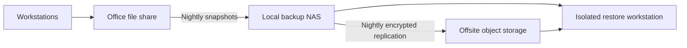

# Backup architecture

Retain 14 daily local snapshots and 30 daily offsite snapshots. Keep the offsite recovery credential separate from the file share administrator account. Verify that the nightly replication completed before counting that snapshot toward the recovery point objective.
